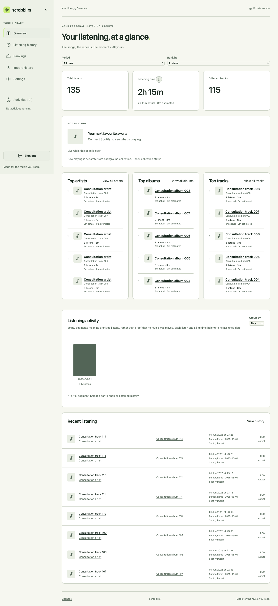
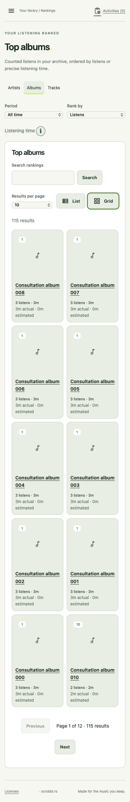

# Exploring your archive

The overview links to complete artist, album and track rankings. Names in rankings
and listening history open the corresponding music page. Artist pages include an
album gallery and track ranking; album pages list their listened tracks. Track
pages link to their artists and album. These lists contain only music with counted
listens in the selected period, rather than an external discography.

Choose a period and rank by listens or listening time. Count ties share competition
positions, such as **1, 2, 2, 4**. Time orders equally played rows; listen counts order
equal-time rows. Names and internal identity provide a deterministic final order.
The secondary measure never breaks a shared position. The server compares precise
milliseconds, even when two displayed times round to the same minute. Each structured
artist receives the whole listen and its full time, so artist totals can exceed the
archive total. Provisional identities remain separate; equal names do not merge them.
Artist rows and filter choices include track context to distinguish provisional names.

Rankings and history offer **10, 25, 50 or 100** results per page, initially 50.
The page size and the rankings' **List / Grid** view belong to the browser. The
album gallery remains a grid and listen history remains a list. URLs preserve
periods, measure, search, filters and page positions for browser Back/Forward and
reloads. Opening a music page carries the period and measure; Back restores the
original ranking selection. Changing filters, order or page size resets page offsets.

## Periods and assigned calendars

Today, this week, this month and this year use each listen's **assigned calendar**.
They stop at the present instant and are labelled incomplete. Defaults are Europe/Rome
and Monday. Changing calendar preferences in Settings can preserve prior assignments
or recalculate all history; consultation uses the published assignments without
rewriting original timestamps. History shows the timezone used for each date/time.

Last 7, 30 and 365 days are exact rolling durations of that many 24-hour days up
to now, including during daylight-saving changes. Custom From/Through dates include
each whole assigned local date; either boundary can be left blank. All time is unbounded.
A change only for new acquisitions can leave different assigned calendars in one archive.
Weekly charts use the stored week start for each listen. If week starts differ,
segments can overlap in calendar dates; each listen still appears in exactly one bar.

## History and listening time

History combines metadata search, period, artist, album and source filters. Search
for an artist or album, then select a matching identity, including identities with
only below-threshold listens. The typeahead shows up to 50 matches; narrow the search
when more match. History initially hides
actual playback below 30 seconds. **Show listens below threshold too** exposes those
archived rows without making them count in statistics. Estimated or unknown duration
alone does not prove a below-threshold play. Further selections expose actual,
estimated/unknown and possible-duplicate rows. Deleted listens are excluded.

Listening time sums **actual** and **estimated** playback, displaying the composition
and the number of **unknown durations**. When every duration is missing, time is
unavailable, rather than zero. Missing durations limit the completeness of time
rankings. The **i** button explains source time, track-length estimates, partial plays,
now-playing progress and reconciliation; use hover, click, touch or keyboard, and
Escape to dismiss it. It does not certify real Spotify/API-export reconciliation.

## Activity charts

The overview and every music page offer day, week, month and year bars, using listens
or listening time. The initial grouping adapts to the interval and can be changed.
Time bars distinguish actual and estimated portions; missing time is labelled unavailable.
Empty segments mean **no archived listens**, rather than evidence of no music playback.
A listen and all its time belong to the assigned date of its canonical timestamp;
its minutes are not split across midnight. Partial segments are marked with an asterisk.

Selecting a bar opens history with the exact segment, entity and original filters.
Clearing the segment restores the wider selection. A day/week/month/year segment
intersects the original period, including rolling-window endpoints. Charts allow at
most 12,000 segments; larger requests ask for a coarser grouping or shorter interval.

## Implementation and verification

The owner-only projections use `/api/v1/consultation/rankings/{kind}`,
`/api/v1/consultation/music/{kind}/{id}` and `/api/v1/consultation/activity`, alongside
the existing dashboard/history endpoints. Kinds are artists, albums and tracks.
The history typeahead uses `/api/v1/consultation/choices/{kind}` for artists/albums.
All these routes require the owner session. Source originals and private configuration are not
returned. This is not the external read API/key contract tracked in the separate
integration work. The canonical predicates in `src/consultation/selection.rs` are
also used by frozen exports; the history default does not change export's default
inclusion of all non-deleted rows.

Counts, rankings and chart projections run in bounded read transactions. Page
counts and their rows share one read view; ranking positions are calculated before
pagination. The dashboard shares the ranking aggregates and caches only bounded
response projections by archive identity, generation, revision, preferences and
absolute selection. Relative periods are recalculated with the clock. Published
calendar-preference changes invalidate the browser's derived projections.

The product contract remains in the [consultation decision](https://github.com/itsmrma/scrobbl-rs/issues/9#issuecomment-6299002083),
with its [assigned-calendar amendment](https://github.com/itsmrma/scrobbl-rs/issues/11#issuecomment-6299753100).
Execution and remaining acceptance checks are recorded in
[Implementare consultazione, pagine musicali e grafici dell’attività](https://github.com/itsmrma/scrobbl-rs/issues/22).

### Synthetic resource measurements — 22 October 2026

Local macOS ARM64, debug build, temporary archive: **100,000 listens / 5,000 tracks**,
with 18 synthetic source files totaling **124,396,022 bytes**. Three sequential HTTP
queries per projection, without a remote source or personal archive. The fixture has
roughly 208 days of activity. Wall-clock ranges below include response projection.
The load test also runs the existing calendar, snapshot and backup checks.

| Projection | Observed range |
| --- | ---: |
| History, first 50 rows | 112–117 ms |
| History, page 1,000 | 204–214 ms |
| Overview | 128 ms first request; 1.1–1.2 ms cached |
| Complete artist/album rankings | 80–88 ms |
| Track ranking, page 50 of 100 rows | 77–79 ms |
| Day/week/month/year activity | 127–138 ms |
| Artist activity | 140 ms |
| Track metadata and totals | 0.4–0.8 ms |

Reproduce with:

```sh
cargo test --locked --test foundations foundation_load -- --ignored --exact --nocapture
```

These are synthetic measurements, not performance acceptance on the owner's full
archive or TrueNAS. Functional tests separately exercise mixed calendars, DST,
unknown/estimated time, ties across page boundaries, inclusive dates, zero buckets
and chart-to-history agreement. Browser automation covers the navigation and controls;
Firefox PC/Mac and Safari on physical iPhone/iPad remain release acceptance checks.

### Browser views

Synthetic data from the consultation browser scenario:




