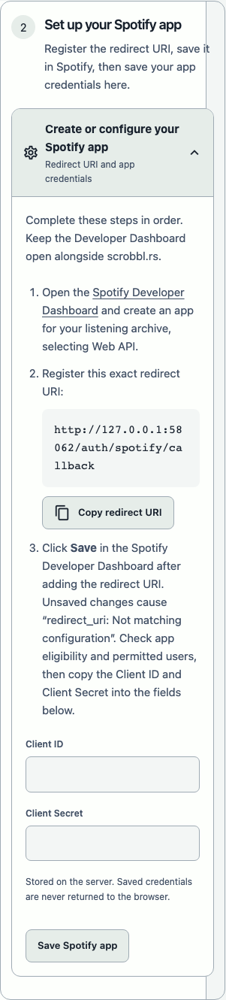
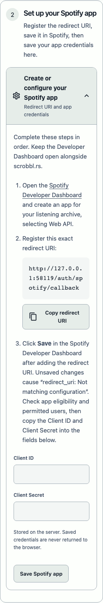
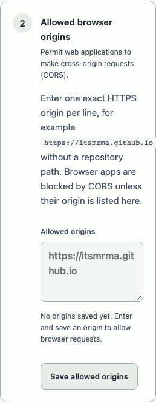
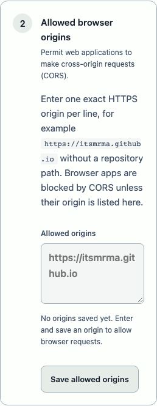
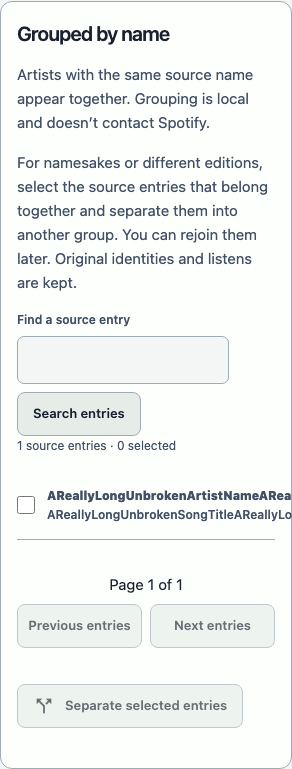
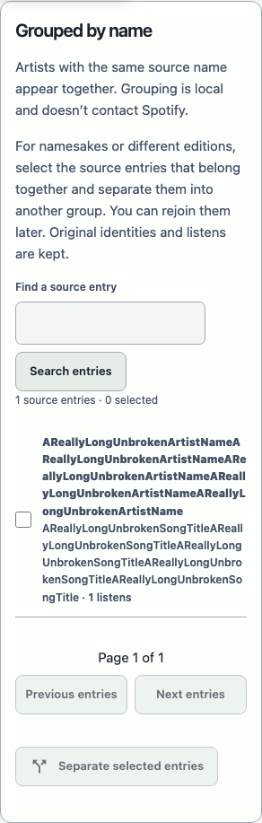
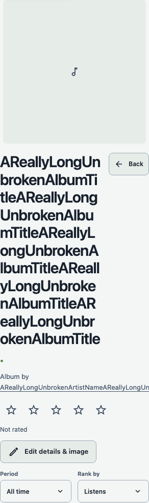
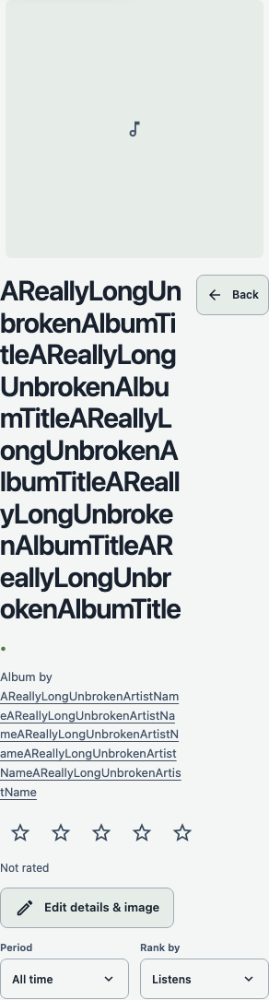

# Controllo responsive — 25 ottobre 2026

Richiesta e criteri: [#82](https://github.com/itsmrma/scrobbl-rs/issues/82), sotto-ticket di [#60](https://github.com/itsmrma/scrobbl-rs/issues/60). Controllo circoscritto a responsività, overflow di testi e pulsanti, preservando l’interfaccia esistente. Workflow Impeccable: contesto, audit tecnico, adattamento e craft floor; riproduzioni browser prima delle correzioni.

## Riscontri e correzioni

| Priorità | Difetto verificato | Causa e correzione |
| --- | --- | --- |
| P2 | A 320 px, espandendo anche la guida HTTPS, i passaggi Spotify misuravano circa 300 px dentro uno spazio di 258 px. | La colonna implicita della griglia conservava la larghezza minima del contenuto. Colonna esplicita `minmax(0, 1fr)`: passaggi e pulsanti vanno a capo nello spazio disponibile. |
| P2 | A 320 px l’URL di esempio CORS superava di 22 px il paragrafo. | `overflow-wrap: anywhere` sul contenuto dei passaggi API, anche per origini salvate e altri identificatori senza spazi. |
| P2 | Con nomi originali senza spazi le voci “Grouped by name” uscivano dal pannello, anche su desktop. | Il contenuto flex manteneva una larghezza minima intrinseca. `min-width: 0` e possibilità di andare a capo sul testo, mantenendo checkbox e azioni. |
| P2 | I crediti di album e brani uscivano dall’intestazione con nomi lunghi. | Andata a capo estesa ai paragrafi dell’intestazione, già presente sul titolo. I collegamenti restano leggibili e funzionanti. |

Le correzioni interessano quattro regole CSS e il foglio distribuito generato dalla build. Nessuna modifica ai dati o ai comportamenti applicativi.

## Copertura automatica

Il test generale visita **22 percorsi × 14 combinazioni di viewport/orientamento = 308 combinazioni per motore**:

- Overview, storico, classifiche artisti/album/brani, import, attività, revisione duplicati, tutte le otto sezioni Settings.
- Schede e modifica di artisti, album e brani.
- 320×740, 375×812, 390×844, 430×932, 600×900, 601×900, 900×900, 901×900, 1100×900, 1101×900, 844×390, 768×1024, 1024×768, 1440×1000.
- Oltre alla larghezza della pagina, verifica la larghezza interna e il contenimento dei pulsanti visibili. Il target trasparente maggiorato dell’aiuto sul tempo è escluso dal controllo dei bordi: si estende intenzionalmente oltre la piccola icona ed è già coperto dai test di accessibilità esistenti.

Due nuovi test riproducono i quattro difetti: guida Spotify espansa e testi/pulsanti API a otto larghezze; import reale di metadati sintetici senza spazi e controllo di crediti e gruppi a 320/601/901/1440 px. I test falliscono con il CSS precedente e passano con le correzioni. Le ellissi dei dropdown e lo scorrimento intenzionale dei contenuti restano invariati. Un segnale di 3 px sul summary Spotify chiuso non corrispondeva a testo o pulsanti fuori dal pannello; non è stato trattato come difetto.

La suite GUI include già tastiera e touch sintetizzato per dropdown, selezione delle mezze stelle, pannelli espandibili e navigazione. Si tratta di automazione browser su macOS, non di certificazione Safari/iOS o di prove su dispositivi fisici.

## Screenshot prima/dopo

Acquisizioni Chromium a larghezza **320 CSS px**, con archivio temporaneo e dati sintetici. I pannelli sono ritagliati direttamente dal browser, senza ridimensionare le immagini. La scheda Spotify usa un viewport alto 2000 px per contenerla interamente; il collegamento fisso di salto al contenuto, fuori schermo e non focalizzato, viene escluso solo dalla cattura per evitare un artefatto di compositing. La baseline usa il CSS distribuito di `ad95dde`; frontend e dati rimangono gli stessi.

| Caso | Prima | Dopo |
| --- | --- | --- |
| Configurazione Spotify |  |  |
| Origini API |  |  |
| Voci originali |  |  |
| Crediti musicali |  |  |

## Verifiche e limiti

- Build TypeScript/Vite riuscita; asset distribuiti aggiornati.
- Detector Impeccable `detect --json frontend/src`: `[]`, exit 0. È un controllo sorgente, non una certificazione visiva.
- Suite GUI e provider immagini WebKit: **65 test riusciti**, incluse le 308 combinazioni responsive.
- Suite completa Chromium: **76 test riusciti**, incluse le 308 combinazioni responsive.
- Firefox locale non avvia il profilo Playwright: `Could not find profile folder`, prima della navigazione, anche dopo reinstallazione del browser e prova con directory temporanea alternativa. Nessun esito positivo Firefox dichiarato.
- Nessuna modifica backend: verifiche Rust di compilazione svolte per avviare il server di prova; suite backend e Docker non rieseguite per queste sole regole CSS.
- CI GitHub lasciata al proprietario dopo il push, senza attesa o monitoraggio.

## Unico collaudo finale

Conservare nel collaudo [#31](https://github.com/itsmrma/scrobbl-rs/issues/31), sul ramo di release stabilizzato: PC/Mac con browser reali, Safari iPhone/iPad in verticale e orizzontale, zoom/testo ingrandito, nomi e URL lunghi reali, apertura completa delle guide e utilizzo dei pulsanti con tastiera/touch. Le verifiche automatiche non attestano questi scenari fisici.
